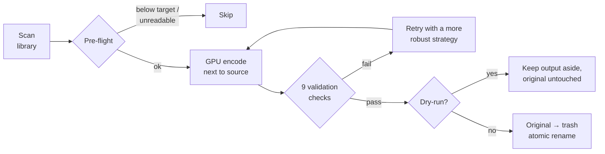

<div align="center">

# Transcodarr

**Never-destructive GPU transcoding for your Jellyfin library.**

A self-hosted Tdarr alternative that re-encodes your media to HEVC or AV1 on Intel GPUs —
and is built so that no code path can ever destroy or corrupt an original file.

[](LICENSE)


[Features](#features) · [Quick start](#quick-start) · [Configuration](#configuration) · [Burn-in](#recommended-burn-in) · [Operations](#operations) · [FAQ](#faq)

</div>

---

## Why Transcodarr?

Bulk re-encoding a media library is risky: a bad filter chain, a truncated output or a
naive Dolby Vision strip can silently ruin thousands of files. Transcodarr treats your
originals as sacred:

- **Dry-run by default** — real encodes, real stats, nothing replaced until you say so.
- **9 blocking validation checks** on every output before it may replace anything.
- **Atomic, reversible replacement** — originals go to a trash bin with retention, never `rm`.
- **Crash-safe** — kill it mid-encode and your files are untouched; stale jobs resume on boot.

Battle-tested on a single-server library of ~70k files.

## Features

### Encoding

- **Hardware encoding** on Intel QSV/VAAPI (Arc, UHD Graphics): HEVC and AV1, 10-bit,
  multi-GPU with per-GPU worker counts and automatic QSV → VAAPI fallback.
- **Bitrate ladders, not CRF guessing** — per-library tables of target/max/bufsize per
  resolution bucket (480p → 2160p) × SDR/HDR, with separate HEVC and AV1 ladders you can
  switch between without retyping.
- **Container-aware track plan** — every track is copied, converted (mov_text → SubRip,
  Blu-ray PCM → FLAC) or excluded with a stated reason, instead of a blind
  `-map 0 -c copy` that breaks the mux. ASS/SSA subtitles are never re-encoded or dropped.
- **Pre-flight checks before touching the GPU** — source readable and not still being
  copied, quick decode test, and a gain prediction calibrated on your real jobs: files
  already below the target bitrate are skipped without encoding.
- **Early no-gain abort** — projected output size is tracked during the encode and a job
  is cancelled only when two slope-based measurements both confirm there's nothing to
  gain. Figures are kept for auditing; estimated "no gain" verdicts can be re-evaluated
  in one click.

### HDR & Dolby Vision

- Full **HDR10 / HDR10+ / HLG** handling, with optional tone-mapping to SDR per library.
- **Profile-aware Dolby Vision** (5 / 7 / 8.1 / 8.2 / 8.4). Profile 5 (IPT-PQ-C2) goes
  through a mandatory libplacebo gamut conversion — never the naive RPU strip that
  produces the infamous green/purple picture. Files that can't be converted safely are
  skipped, never botched.
- HDR10 mastering metadata (MDCV / MaxCLL) is always present in the output, from the
  source, the DV RPU (L6) or logged safe defaults.

### Safety

- **9 validation checks**, all blocking: exit code, output integrity (full CPU decode),
  duration, stream completeness, size gain, HDR colorimetry (BT.2020/PQ flags, MDCV/MaxCLL
  present, no residual DOVI), and a DV anti-color-shift check (SSIM + chroma delta against
  a profile-correct reference decode).
- **Atomic replacement** — encodes are written next to the source (same filesystem →
  atomic `rename()`); mtime, owner and permissions are restored.
- **Anti-loop marker** — a container tag records the settings each file was encoded with.
  Files are only re-queued when *your config* changes or when Radarr/Sonarr upgrades the
  file (detected by content, not name). A mid-encode guard stops a stale encode from ever
  overwriting a fresh upgrade.
- **Self-healing failures** — every failure is classified (incompatible subtitles, data
  tracks, corrupt source, timestamps, GPU encoder error…) with the relevant FFmpeg lines.
  File-caused failures are retried with increasingly robust strategies (tolerant decoding
  → lossless SubRip rebuild → mkvmerge assembly copying original audio/subs bit for bit →
  strict track allowlist → the GPU's other API). Permanent failures are never retried in
  a loop.

### Web UI

- React dashboard (dark theme, mobile-friendly, English/French) with live per-worker
  progress, and stats over 24 h / 7 d / 30 d / all: success rate, failure causes, space
  saved, throughput, gain per resolution bucket, library codec split.
- Queue with drag-to-reorder, filterable history of every attempt, failures view with
  bulk retry.
- Per-job diagnostics: cause and remedy, pre-flight result, track plan, validation
  report, attempt timeline, exact FFmpeg command, searchable live logs.
- Library, GPU and settings management — **everything hot-reloaded**, no restarts.
- Interactive API docs at `/api/docs`.

## How it works



## Requirements

| | |
|---|---|
| **Host** | Linux, x86_64 |
| **GPU** | Intel GPU with HEVC and/or AV1 encode (tested on Arc A770). Kernel ≥ 6.2 for Arc, `intel-media-va-driver-non-free`, working `/dev/dri` |
| **Software** | Docker + Docker Compose. PostgreSQL ships in the compose file |

Check your GPU stack on the host and inside the container:

```bash
./scripts/check_gpu.sh              # on the host
./scripts/check_gpu.sh --container  # inside the running container
```

## Quick start

```bash
git clone https://github.com/literalynn/transcodarr.git /opt/transcodarr
cd /opt/transcodarr
cp .env.example .env
nano .env    # set MEDIA_ROOT, RENDER_GID, PUID/PGID and a real POSTGRES_PASSWORD
docker compose up -d --build
```

Then open `http://<host>:8080`.

On first start, database migrations and the seed run automatically, and the app probes
your GPU with short real test encodes. Before going further:

1. **You're in dry-run.** A full-width banner reminds you — nothing gets replaced.
2. **Review the seeded defaults.** The first start creates three example libraries
   (`Movies`, `TV Shows` and `Anime` under `MEDIA_ROOT`) with tuned bitrate ladders, and
   one GPU entry (`/dev/dri/renderD128`, QSV). Edit or delete them in **Libraries** and
   **GPU & Settings** to match your setup — they're only created once.
3. **Run GPU & Settings → Test GPU** and make sure the HEVC/AV1 test encodes pass.

### Updating

```bash
cd /opt/transcodarr
git pull
docker compose up -d --build
```

Migrations are applied automatically at startup. Back up first (see [Backups](#backups)).

## Configuration

`.env` only holds infrastructure settings:

| Variable | Default | Description |
|---|---|---|
| `HTTP_PORT` | `8080` | Port the web UI is published on |
| `POSTGRES_USER` / `POSTGRES_PASSWORD` / `POSTGRES_DB` | `transcoder` / `change_me` / `transcoder` | Database credentials — **change the password** |
| `MEDIA_ROOT` | `/srv/storage` | Common parent of all your libraries, mounted **at the same absolute path** in the container, so you can add libraries from the UI without editing the compose file |
| `SANDBOX_ROOT` | `/srv/storage/_transcoder_sandbox` | Where `make_sample_set.sh` builds the burn-in sample |
| `DRI_DEVICE` | `/dev/dri` | GPU device directory passed to the container |
| `RENDER_GID` | `993` | Numeric GID of the host `render` group: `getent group render \| cut -d: -f3` |
| `PUID` / `PGID` | `1000` | The app runs as this user and restores file ownership on replacement — use your media owner |
| `DRY_RUN` | `true` | Initial global dry-run value |
| `TRASH_RETENTION_DAYS` | `14` | Initial trash retention |
| `MAX_CONCURRENT_JOBS` | `1` | Initial concurrency |

The last three are **seeded once** on first start; after that they're managed in the UI.
Everything else — bitrate ladders, HDR/DV policies, thresholds, concurrency, scan
schedules, Jellyfin integration — lives in the database and is edited live in the UI.
Config can be exported and imported as JSON.

> [!WARNING]
> Transcodarr has **no built-in authentication**. Anyone who can reach the web UI can
> change settings and trigger jobs. Keep it on your LAN or put it behind a reverse proxy
> with authentication — never expose it directly to the internet.

## Recommended burn-in

Before letting Transcodarr loose on your real library:

1. Start the stack and pass **GPU & Settings → Test GPU**.
2. Build a sandbox from real files of your collection (reflink-aware, mtime-preserving):
   ```bash
   ./scripts/make_sample_set.sh --dv --hdr --already-hevc -n 5
   ```
   It samples every top-level folder of `MEDIA_ROOT` by default; restrict it with
   `--lib "Movies" --lib "TV Shows"`. Targeted selection (`--dv`, `--hdr`…) needs
   `ffprobe` on the host.
3. Create sandbox libraries in the UI, scan, and watch the queue and live logs.
4. Check outputs with `ffprobe` (see below).
5. Disable dry-run **on the sandbox library only**. Verify atomic replacement, trash
   contents, preserved mtime/permissions, and practice a rollback — files in the trash are
   plain files, just `mv` them back.
6. Create your real libraries with 1 worker, watch the first jobs, then scale workers up
   and switch validation decode to `sample` for throughput.

### Expected results

| Input | Outcome |
|---|---|
| H.264 SDR | Re-encoded at the ladder bitrate; audio, subtitles, chapters and fonts untouched |
| Already in target codec, tagged | Never re-queued while the config is unchanged |
| HDR10 (4K) | 10-bit, BT.2020/PQ flags and MDCV/MaxCLL present |
| Dolby Vision P5 | Valid HDR10 via libplacebo gamut conversion with zero DOVI side data — or `skipped (policy)` if libplacebo lacks DV support. Never best-effort |
| Dolby Vision P7 / 8.1 | Base layer re-encoded to clean HDR10 |
| Dolby Vision 8.2 (SDR base) | Treated as SDR, BT.709 flags |
| HDR10+ | Converted to static HDR10 (dynamic metadata can't survive a re-encode), reported as such |
| Corrupt source / truncated output | Validation fails, original intact |
| Older than the library date filter | `ignored`, reversible |

Verification one-liners:

```bash
# codec and colorimetry
ffprobe -v error -select_streams v:0 -show_entries \
  stream=codec_name,color_primaries,color_transfer,color_space,pix_fmt -of default=nw=1 file.mkv
# residual Dolby Vision side data — must print 0
ffprobe -v error -select_streams v:0 -show_frames -read_intervals "%+#1" file.mkv | grep -c DOVI
# Transcodarr marker tag
ffprobe -v error -show_entries format_tags=TRANSCODER_TAG -of default=nw=1 file.mkv
```

## Operations

### Backups

```bash
./scripts/backup.sh                                  # pg_dump + JSON config → backups/
./scripts/restore.sh backups/<archive>.tar.gz        # full database restore
./scripts/restore.sh backups/<archive>.tar.gz --config  # config only
```

All state lives in the bind-mounted `data/` folder, which can also be archived with `tar`
as-is. `./scripts/reset.sh` wipes containers, database, state and sandbox (with
confirmation) — your media libraries are never touched.

### Good to know

- **Trash location** — the default trash is `data/trash`, which is usually on a different
  filesystem than your media. Point it (**GPU & Settings**) to a folder on the same
  filesystem, e.g. `${MEDIA_ROOT}/.transcodarr/trash`, so replacements are instant renames
  instead of cross-device copies.
- **Temp files** — encodes go to `<file dir>/.transcoder_tmp/` (same filesystem → atomic
  rename). A central temp dir is only used when it's verifiably on the same filesystem.
- **Crash safety** — a brutal `docker compose down` mid-encode leaves originals untouched;
  on boot, stale jobs are re-queued and orphan temp files purged. The Queue page also has
  buttons to recover stuck jobs and re-queue dry-run-only files.
- **"Date added" filter** — uses Jellyfin's `DateCreated` (if a Jellyfin URL + API key are
  configured) → file birth time → mtime. `ctime` is never used (any chown/chmod rewrites
  it). Jellyfin keeps the original `DateCreated` across quality upgrades: if you want
  upgrades re-encoded, rely on mtime and leave the Jellyfin integration off.
- **MP4 output** is supported but lossy by nature (no font attachments, text subs become
  mov_text, image subs fail explicitly). MKV is the default for a reason.

## FAQ

<details>
<summary><b>Does it support NVIDIA (NVENC) or AMD (AMF)?</b></summary>

Not currently. Encoding targets Intel QSV/VAAPI only. Software encoding is used in the
test suite but isn't exposed as a production encoder.
</details>

<details>
<summary><b>Does it work with Plex or Emby?</b></summary>

Transcodarr works on files, so any media server pointing at the same folders will pick up
the re-encoded files. The optional integration (reliable "date added") is Jellyfin-only.
</details>

<details>
<summary><b>Will it fight with Radarr/Sonarr?</b></summary>

No. Upgrades are detected by content, not by name, and re-encoded once. A file upgraded
while it's being encoded is never overwritten by the stale encode.
</details>

<details>
<summary><b>How do I roll back a file?</b></summary>

Originals sit in the trash folder as plain files until the retention period expires. Move
the file back over the encoded one.
</details>

## Development

```bash
docker compose exec app python -m pytest -q
```

The 400+ tests need no GPU. They cover the FFmpeg command builder (codec × HDR × DV
profile matrix), the DV decision matrix, every validation check, anti-loop logic and
atomic replacement on a real filesystem, plus a software-encoder end-to-end run (source →
encode → 9 validations → tag round-trip). When the database is reachable it also runs a
DB-backed pipeline test (claim → encode → validate → replace), recovery scenarios and an
`alembic check` guarding model/migration drift.

**Stack:** FastAPI · SQLAlchemy 2 (async) · PostgreSQL 16 · Alembic · asyncio workers
claiming jobs with `SELECT … FOR UPDATE SKIP LOCKED` · APScheduler for scan schedules ·
WebSockets for live progress and logs · React 18 + Vite + Tailwind + shadcn/ui ·
`jellyfin-ffmpeg`, `dovi_tool`, `mkvtoolnix`.

Design decisions and their rationale are journaled in [DECISIONS.md](DECISIONS.md).
Note that code comments and `DECISIONS.md` are written in French.

## Contributing

Issues and pull requests are welcome. For anything beyond a small fix, please open an
issue first to discuss the approach. Bug reports are most useful with the job's
diagnostic panel output (FFmpeg command, failure cause and logs) and your GPU model.

## Acknowledgements

Built on the shoulders of [jellyfin-ffmpeg](https://github.com/jellyfin/jellyfin-ffmpeg),
[dovi_tool](https://github.com/quietvoid/dovi_tool),
[MKVToolNix](https://mkvtoolnix.download/) and
[libplacebo](https://code.videolan.org/videolan/libplacebo).

## License

[GPL-3.0](LICENSE)
